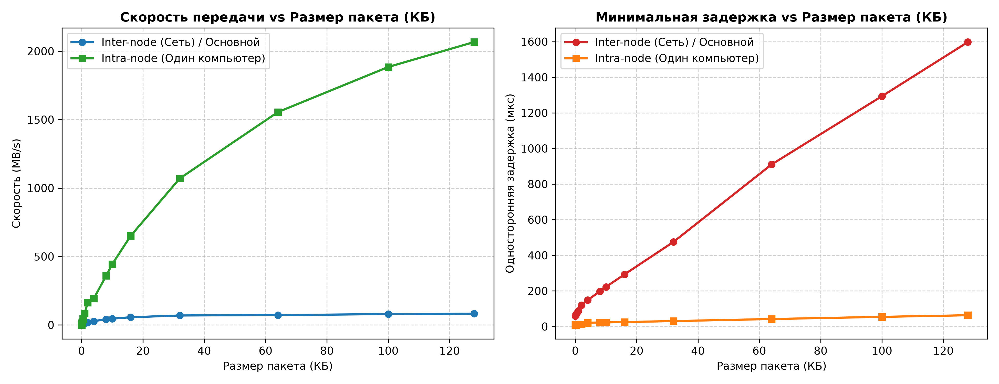
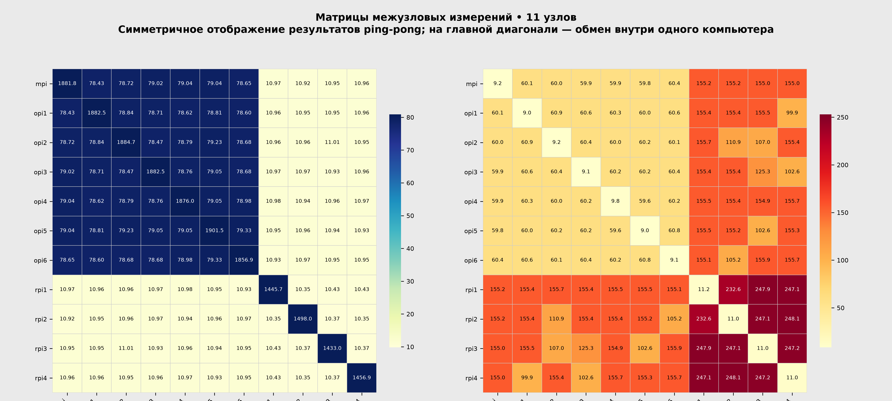
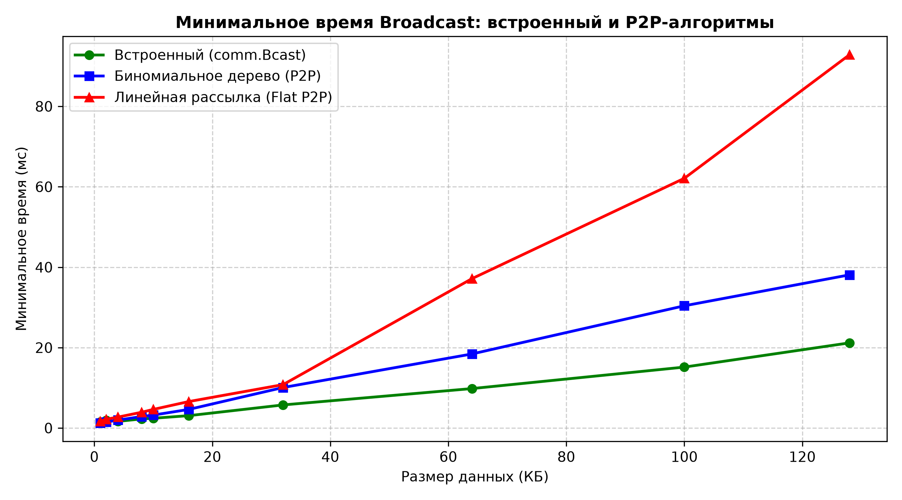

## Анализ свойств кластера «СКИФ-π»

### 1. Методика эксперимента

* Для каждого размера пакета выполнялся предварительный прогрев, после чего проводилась серия замеров (от 50 до 1000 итераций) с фиксацией **минимального времени** (`np.min`), что позволяет исключить выбросы, вызванные планировщиком ОС и фоновыми системными процессами.
* **Топология запуска:** для одновременного измерения как межузловых каналов (`Inter-node`), так и обмена внутри одного компьютера через разделяемую память (`Intra-node`) на всех 11 узлах запускалось по 2 MPI-процесса:

  ```
  srun -p all -n 22 --nodes=11 --ntasks-per-node=2 python3 cluster_benchmark.py --output-dir results
  ```
  
* Для запуска доступны следующие аргументы:
	`--all` - запуск всех модулей бенчмарка (по умолчанию),  
	`--network` - запуск только Модуля 1: Сеть P2P (Send/Recv)  
	`--hardware` - запуск только Модуля 2: Оборудование узлов и GFlop/s  
	`--collectives` - запуск только Модуля 3: Коллективные операции против P2P  
	`--max-packet-kb` - установка максимального размера пакета в КБ (по умолчанию: 128)  
	`--output-dir` - создание/выбор директории для сохранения CSV и графиков  
	`--quick` - быстрый режим работы (ограничение пакетов до 16 КБ)

### 2. Исследование характеристик коммуникационной среды («точка-точка», `comm.Send` / `comm.Recv`)

#### 2.1. Сравнение внутриузлового (`Intra-node`) и межузлового (`Inter-node`) обмена (от 0 Б до 128 КБ)

В ходе эксперимента сравнивались два режима передачи сообщений методом *Ping-Pong*:

1. **Intra-node** — обмен между процессами `Rank 0` и `Rank 1` на одном узле (`mpi`) через разделяемую память.
2. **Inter-node** — обмен по локальной сети Ethernet между процессами на разных узлах (`mpi: Rank 0` $\leftrightarrow$ `opi1: Rank 2`).

| Размер пакета | Intra-node: мин. задержка (мкс) | Intra-node: скорость (МБ/с) | Intra-node: скорость (Мбит/с) | Inter-node: мин. задержка (мкс) | Inter-node: скорость (МБ/с) | Inter-node: скорость (Мбит/с) |
| ------------- | ------------------------------- | --------------------------- | ----------------------------- | ------------------------------- | --------------------------- | ----------------------------- |
| **0 B**       | 8.48                            | 0.00                        | 0.00                          | 58.94                           | 0.00                        | 0.00                          |
| **1 B**       | 9.13                            | 0.11                        | 0.88                          | 59.52                           | 0.02                        | 0.13                          |
| **2 B**       | 9.06                            | 0.22                        | 1.77                          | 59.69                           | 0.03                        | 0.27                          |
| **4 B**       | 9.04                            | 0.44                        | 3.54                          | 60.12                           | 0.07                        | 0.53                          |
| **8 B**       | 9.06                            | 0.88                        | 7.06                          | 59.58                           | 0.13                        | 1.07                          |
| **16 B**      | 9.06                            | 1.77                        | 14.12                         | 60.44                           | 0.26                        | 2.12                          |
| **32 B**      | 9.10                            | 3.51                        | 28.12                         | 60.65                           | 0.53                        | 4.22                          |
| **64 B**      | 9.10                            | 7.03                        | 56.24                         | 61.67                           | 1.04                        | 8.30                          |
| **128 B**     | 9.13                            | 14.03                       | 112.22                        | 64.54                           | 1.98                        | 15.87                         |
| **256 B**     | 9.38                            | 27.31                       | 218.45                        | 67.90                           | 3.77                        | 30.16                         |
| **512 B**     | 12.00                           | 42.67                       | 341.35                        | 75.02                           | 6.82                        | 54.60                         |
| **1.0 KB**    | 12.13                           | 84.45                       | 675.63                        | 88.54                           | 11.57                       | 92.52                         |
| **2.0 KB**    | 12.56                           | 163.02                      | 1304.20                       | 119.75                          | 17.10                       | 136.82                        |
| **4.0 KB**    | 21.17                           | 193.51                      | 1548.11                       | 148.69                          | 27.55                       | 220.38                        |
| **8.0 KB**    | 22.81                           | 359.11                      | 2872.87                       | 197.08                          | 41.57                       | 332.53                        |
| **10.0 KB**   | 23.06                           | 444.02                      | 3552.16                       | 222.85                          | 45.95                       | 367.60                        |
| **16.0 KB**   | 25.19                           | 650.48                      | 5203.85                       | 292.33                          | 56.05                       | 448.37                        |
| **32.0 KB**   | 30.62                           | 1069.98                     | 8559.80                       | 475.16                          | 68.96                       | 551.69                        |
| **64.0 KB**   | 42.15                           | 1554.99                     | 12439.95                      | 910.26                          | 72.00                       | 575.97                        |
| **100.0 KB**  | 54.33                           | 1884.67                     | 15077.39                      | 1293.74                         | 79.15                       | 633.20                        |
| **128.0 KB**  | 63.42                           | 2066.86                     | 16534.88                      | 1597.70                         | 82.04                       | 656.30                        |



**Анализ зависимостей на графике:**
* На малых пакетах время передачи практически не зависит от объема данных и определяется накладными расходами программного стека MPI и сетевого интерфейса. Внутри одного узла минимальная задержка составляет **8.48–9.38 мкс**, тогда как при выходе в сеть Ethernet возрастает почти в **7 раз** — до **58.94–67.90 мкс**.
* При переходе от `2 КБ` к `4 КБ` в режиме `Intra-node` наблюдается скачок задержки с `12.56 мкс` до `21.17 мкс`, обусловленный переключением внутреннего алгоритма Open MPI с короткого протокола (копирование через буферы) на протокол с подтверждением готовности.
* На левом графике кривая скорости `Inter-node` (синяя) быстро насыщается в районе **79.15–82.04 МБ/с** (`633–656 Мбит/с`), что соответствует эффективной пропускной способности гигабитного канала (1 Гбит/с) за вычетом заголовков Ethernet/IP/TCP.
* Кривая `Intra-node` (зеленая) продолжает интенсивно расти на всем диапазоне до 128 КБ, достигая **1884.67 МБ/с** на 100 КБ и **2066.86 МБ/с** (`16.53 Гбит/с`) на 128 КБ (в **25.2 раза быстрее** сетевого обмена), так как данные передаются через кэш процессора и оперативную память.
* На правом графике подтверждается линейный характер зависимости минимальной односторонней задержки $T(s)$ от размера пакета: на 128 КБ время доставки по сети достигает **1597.70 мкс**, а внутри узла — всего **63.42 мкс**.

#### 2.2. Параметры аналитической модели Хокни

По экспериментальным точкам выполнена линейная аппроксимация модели Хокни:

$$T(s) = \alpha + \frac{s}{\beta}$$

где $\alpha$ — стартовая задержка сообщения (латентность), $\beta$ — асимптотическая пропускная способность канала, $n_{1/2} = \alpha \cdot \beta$ — размер сообщения половинной производительности.

| Параметр модели Хокни                          | Intra-node (`mpi:0` $\leftrightarrow$ `mpi:1`) | Inter-node (`mpi:0` $\leftrightarrow$ `opi1:2`) | Соотношение (Inter / Intra) |
| ---------------------------------------------- | ---------------------------------------------- | ----------------------------------------------- | --------------------------- |
| **Стартовая задержка (**$\alpha$**)**          | 12.23 мкс                                      | 75.90 мкс                                       | в 6.21 раза выше            |
| **Асимптотическая скорость (**$\beta$**)**     | 2387.40 МБ/с (19.10 Гбит/с)                    | 84.08 МБ/с (0.67 Гбит/с)                        | в 28.40 раза ниже           |
| **Размер половинной мощности (**$n_{1/2}$**)** | 28.5 КБ (29 187 Б)                             | 6.2 КБ (6 382 Б)                                | в 4.57 раза меньше          |

**Вывод по модели:** для межузлового обмена сообщения короче **6.2 КБ** являются *латентностно-ограниченными* (основное время тратится на инициализацию передачи $\alpha$), а свыше **6.2 КБ** — *ограниченными пропускной способностью* ($\beta$). Внутри одного узла из-за высокой скорости шины памяти порог $n_{1/2}$ смещается к **28.5 КБ**.

#### 2.3. Матрицы межузловых и внутриузловых измерений ($11 \times 11$ узлов)

Для анализа топологии всего кластера (11 узлов: управляющий узел `mpi`, 6 вычислительных узлов `opi1–opi6` и 4 узла `rpi1–rpi4`) построены симметричные матрицы:
* **Пропускной способности** (МБ/с) на пакетах размером **100 КБ**.
* **Минимальной односторонней задержки** (мкс) на пакетах размером **1 Б**.
* **Главная диагональ (**$i = j$**)** отражает скорость и латентность обмена **внутри одного компьютера** между двумя локальными MPI-процессами.

##### Матрица пропускной способности (МБ/с, пакет 100 КБ)

| Узел     | mpi         | opi1        | opi2        | opi3        | opi4        | opi5        | opi6        | rpi1        | rpi2        | rpi3        | rpi4        |
| -------- | ----------- | ----------- | ----------- | ----------- | ----------- | ----------- | ----------- | ----------- | ----------- | ----------- | ----------- |
| **mpi**  | **1881.80** | 78.43       | 78.72       | 79.02       | 79.04       | 79.04       | 78.65       | 10.97       | 10.92       | 10.95       | 10.96       |
| **opi1** | 78.43       | **1882.51** | 78.84       | 78.71       | 78.62       | 78.81       | 78.60       | 10.96       | 10.95       | 10.95       | 10.96       |
| **opi2** | 78.72       | 78.84       | **1884.67** | 78.47       | 78.79       | 79.23       | 78.68       | 10.96       | 10.96       | 11.01       | 10.95       |
| **opi3** | 79.02       | 78.71       | 78.47       | **1882.51** | 78.76       | 79.05       | 78.68       | 10.97       | 10.97       | 10.93       | 10.96       |
| **opi4** | 79.04       | 78.62       | 78.79       | 78.76       | **1876.04** | 79.05       | 78.98       | 10.98       | 10.94       | 10.96       | 10.97       |
| **opi5** | 79.04       | 78.81       | 79.23       | 79.05       | 79.05       | **1901.45** | 79.33       | 10.95       | 10.96       | 10.94       | 10.93       |
| **opi6** | 78.65       | 78.60       | 78.68       | 78.68       | 78.98       | 79.33       | **1856.89** | 10.93       | 10.97       | 10.95       | 10.95       |
| **rpi1** | 10.97       | 10.96       | 10.96       | 10.97       | 10.98       | 10.95       | 10.93       | **1445.66** | 10.35       | 10.43       | 10.43       |
| **rpi2** | 10.92       | 10.95       | 10.96       | 10.97       | 10.94       | 10.96       | 10.97       | 10.35       | **1497.98** | 10.37       | 10.35       |
| **rpi3** | 10.95       | 10.95       | 11.01       | 10.93       | 10.96       | 10.94       | 10.95       | 10.43       | 10.37       | **1433.00** | 10.37       |
| **rpi4** | 10.96       | 10.96       | 10.95       | 10.96       | 10.97       | 10.93       | 10.95       | 10.43       | 10.35       | 10.37       | **1456.89** |

##### Матрица минимальной односторонней задержки (мкс, пакет 1 Б)

| Узел     | mpi     | opi1    | opi2    | opi3    | opi4    | opi5    | opi6    | rpi1     | rpi2     | rpi3     | rpi4     |
| -------- | ------- | ------- | ------- | ------- | ------- | ------- | ------- | -------- | -------- | -------- | -------- |
| **mpi**  | **9.2** | 60.1    | 60.0    | 59.9    | 59.9    | 59.8    | 60.4    | 155.2    | 155.2    | 155.0    | 155.0    |
| **opi1** | 60.1    | **9.0** | 60.9    | 60.6    | 60.3    | 60.0    | 60.6    | 155.4    | 155.4    | 155.5    | 99.9     |
| **opi2** | 60.0    | 60.9    | **9.2** | 60.4    | 60.0    | 60.2    | 60.1    | 155.7    | 110.9    | 107.0    | 155.4    |
| **opi3** | 59.9    | 60.6    | 60.4    | **9.1** | 60.2    | 60.2    | 60.4    | 155.4    | 155.4    | 125.3    | 102.6    |
| **opi4** | 59.9    | 60.3    | 60.0    | 60.2    | **9.8** | 59.6    | 60.2    | 155.5    | 155.4    | 154.9    | 155.7    |
| **opi5** | 59.8    | 60.0    | 60.2    | 60.2    | 59.6    | **9.0** | 60.8    | 155.5    | 155.2    | 102.6    | 155.3    |
| **opi6** | 60.4    | 60.6    | 60.1    | 60.4    | 60.2    | 60.8    | **9.1** | 155.1    | 105.2    | 155.9    | 155.7    |
| **rpi1** | 155.2   | 155.4   | 155.7   | 155.4   | 155.5   | 155.5   | 155.1   | **11.2** | 232.6    | 247.9    | 247.1    |
| **rpi2** | 155.2   | 155.4   | 110.9   | 155.4   | 155.4   | 155.2   | 105.2   | 232.6    | **11.0** | 247.1    | 248.1    |
| **rpi3** | 155.0   | 155.5   | 107.0   | 125.3   | 154.9   | 102.6   | 155.9   | 247.9    | 247.1    | **11.0** | 247.2    |
| **rpi4** | 155.0   | 99.9    | 155.4   | 102.6   | 155.7   | 155.3   | 155.7   | 247.1    | 248.1    | 247.2    | **11.0** |



**Анализ блочно-диагональной структуры тепловых карт:**
На обеих тепловых картах отчетливо выделяются 4 коммуникационных домена кластера:

1. **Главная диагональ (обмен внутри одного компьютера):**
   * Узлы группы `Orange Pi` (`mpi`, `opi1–opi6`): скорость **1856.89–1901.45 МБ/с** (в среднем **1880.84 МБ/с**), задержка **9.0–9.8 мкс** (в среднем **9.20 мкс**).
   * Узлы группы `Raspberry Pi` (`rpi1–rpi4`): скорость **1433.00–1497.98 МБ/с** (в среднем **1458.38 МБ/с**), задержка **11.0–11.2 мкс** (в среднем **11.05 мкс**).

2. **Сегмент `Orange Pi`** $\leftrightarrow$ **`Orange Pi` (темно-синий квадрат** $7 \times 7$ **слева и светло-желтый квадрат справа):**
   * Однородная гигабитная сеть (1 Гбит/с): пропускная способность стабильно держится в узком диапазоне **78.43–79.33 МБ/с** (среднее **78.83 МБ/с**), односторонняя латентность — **59.6–60.9 мкс** (среднее **60.22 мкс**).

3. **Сегмент `Raspberry Pi`** $\leftrightarrow$ **`Raspberry Pi` (нижний правый квадрат** $4 \times 4$**):**
   * Сеть Fast Ethernet (100 Мбит/с): скорость ограничена каналом на уровне **10.35–10.43 МБ/с** (среднее **10.38 МБ/с** — в **7.6 раза ниже**, чем между узлами `opi`), а базовая задержка возрастает до **232.6–248.1 мкс** (среднее **245.00 мкс** — в **4.07 раза выше**, чем в сегменте `opi`).

4. **Межсегментные связи `Orange Pi`** $\leftrightarrow$ **`Raspberry Pi`:**
   * Пропускная способность лимитируется 100-мегабитным портом узлов `rpi` и составляет **10.92–11.01 МБ/с** (среднее **10.96 МБ/с**).
   * Односторонняя задержка для большинства пар составляет **154.9–155.9 мкс** (промежуточное значение между задержками сегментов `opi` и `rpi`), а для отдельных пар (`opi1–rpi4`, `opi2–rpi2`, `opi2–rpi3`, `opi3–rpi3`, `opi3–rpi4`, `opi5–rpi3`, `opi6–rpi2`) фиксируется на уровне **99.9–125.3 мкс** (более светлые оранжевые ячейки на правой тепловой карте).

### 3. Аппаратные характеристики узлов и вычислительная производительность ($\text{GFlop/s}$)

Для оценки вычислительной мощности узлов при одновременной нагрузке на все 11 узлов (22 процесса, по 2 процесса на узел) выполнены:

* **DGEMM** — перемножение плотных матриц двойной точности (`float64`, $N \in \{500, 1000, 1500\}$, формула $\text{GFlop/s} = \frac{2N^3}{T_{\min} \cdot 10^9}$).
* **Vector FMA** — векторное умножение со сложением ($y = y \cdot \alpha + \beta$ на массиве из $5 \cdot 10^6$ элементов `float64`).

| Узел      | MPI Ранги    | Модель CPU        | Физ. ядра | Лог. ядра | ОЗУ всего     | ОЗУ доступно  | Пик GEMM на узел ($\text{GFlop/s}$) | Vector FMA на узел ($\text{GFlop/s}$) |
| --------- | ------------ | ----------------- | --------- | --------- | ------------- | ------------- | ----------------------------------- | ------------------------------------- |
| **mpi**   | 0, 1         | Unknown CPU (ARM) | 2         | 4         | 0.9 ГБ (0.95) | 0.8 ГБ (0.77) | 0.44                                | 0.10                                  |
| **opi1**  | 2, 3         | Unknown CPU (ARM) | 2         | 4         | 0.9 ГБ (0.95) | 0.8 ГБ (0.80) | 0.44                                | 0.10                                  |
| **opi2**  | 4, 5         | Unknown CPU (ARM) | 2         | 4         | 0.9 ГБ (0.95) | 0.8 ГБ (0.80) | 0.44                                | 0.10                                  |
| **opi3**  | 6, 7         | Unknown CPU (ARM) | 2         | 4         | 0.9 ГБ (0.95) | 0.8 ГБ (0.80) | 0.44                                | 0.10                                  |
| **opi4**  | 8, 9         | Unknown CPU (ARM) | 2         | 4         | 0.9 ГБ (0.95) | 0.8 ГБ (0.80) | 0.44                                | 0.10                                  |
| **opi5**  | 10, 11       | Unknown CPU (ARM) | 2         | 4         | 0.9 ГБ (0.95) | 0.8 ГБ (0.80) | 0.44                                | 0.10                                  |
| **opi6**  | 12, 13       | Unknown CPU (ARM) | 2         | 4         | 0.9 ГБ (0.95) | 0.8 ГБ (0.80) | 0.44                                | 0.10                                  |
| **rpi1**  | 14, 15       | Unknown CPU (ARM) | 2         | 4         | 0.9 ГБ (0.93) | 0.7 ГБ (0.72) | 0.37                                | 0.09                                  |
| **rpi2**  | 16, 17       | Unknown CPU (ARM) | 2         | 4         | 0.9 ГБ (0.93) | 0.7 ГБ (0.74) | 0.37                                | 0.09                                  |
| **rpi3**  | 18, 19       | Unknown CPU (ARM) | 2         | 4         | 0.9 ГБ (0.93) | 0.7 ГБ (0.74) | 0.37                                | 0.09                                  |
| **rpi4**  | 20, 21       | Unknown CPU (ARM) | 2         | 4         | 0.9 ГБ (0.93) | 0.8 ГБ (0.75) | 0.37                                | 0.09                                  |
| **ИТОГО** | **22 ранга** | **11 узлов**      | **22**    | **44**    | **10.37 ГБ**  | **8.62 ГБ**   | **4.53** $\text{GFlop/s}$           | **1.03** $\text{GFlop/s}$             |

**Выводы по аппаратным ресурсам и производительности:**

1. **Совокупные ресурсы кластера:** 11 физических узлов предоставляют 22 физических (44 логических) ядра, **10.37 ГБ** оперативной памяти и суммарную производительность **4.53** $\text{GFlop/s}$ в тесте матричного умножения DGEMM.
2. Узлы `mpi`, `opi1–opi6` демонстрируют производительность **0.44** $\text{GFlop/s}$ на узел (`0.22 GFlop/s` на процесс) в тесте GEMM и **0.10** $\text{GFlop/s}$ в тесте FMA, опережая узлы `rpi1–rpi4` (**0.37** $\text{GFlop/s}$ на узел, `0.19 GFlop/s` на процесс) примерно на **19%**.
3. **Особенность определения CPU:** на платформе ARM в системном файле `/proc/cpuinfo` отсутствует поле `model name` (характерное для архитектуры x86_64), поэтому модуль корректно распознает количество ядер и объем ОЗУ, отображая модель процессора как `Unknown CPU`.

### 4. Сравнение коллективных операций и P2P-алгоритмов (`Bcast` и `Reduce`)

На всех 22 процессах (11 узлов) проведено сравнение минимального времени выполнения:
* **Built-in (`comm.Bcast`, `comm.Reduce`)** — оптимизированные встроенные примитивы Open MPI.
* **P2P Flat** — линейная рассылка/сбор корневым процессом (`rank 0`) последовательно всем остальным рангам.
* **P2P Tree** — пользовательский алгоритм на основе биномиального/бинарного дерева пересылок.

#### 4.1. `Broadcast`

| Размер данных | `comm.Bcast` (мс) | `P2P Flat` (мс) | `P2P Tree` (мс) | Ускорение над `Flat` | Ускорение над `Tree` | Скорость `comm.Bcast` (МБ/с) |
| ------------- | ----------------- | --------------- | --------------- | -------------------- | -------------------- | ---------------------------- |
| **1.0 KB**    | 1.4902            | 1.6982          | 1.2299          | 1.14x                | 0.83x                | 0.69                         |
| **2.0 KB**    | 1.8795            | 2.1830          | 1.4868          | 1.16x                | 0.79x                | 1.09                         |
| **4.0 KB**    | 1.6570            | 2.7131          | 1.9669          | 1.64x                | 1.19x                | 2.47                         |
| **8.0 KB**    | 2.2639            | 3.9207          | 2.8529          | 1.73x                | 1.26x                | 3.62                         |
| **10.0 KB**   | 2.4313            | 4.6307          | 3.2193          | 1.90x                | 1.32x                | 4.21                         |
| **16.0 KB**   | 3.0740            | 6.5796          | 4.6249          | 2.14x                | 1.50x                | 5.33                         |
| **32.0 KB**   | 5.7441            | 10.8006         | 10.0753         | 1.88x                | 1.75x                | 5.70                         |
| **64.0 KB**   | 9.8105            | 37.1423         | 18.4170         | 3.79x                | 1.88x                | 6.68                         |
| **100.0 KB**  | 15.1533           | 62.0982         | 30.3985         | 4.10x                | 2.01x                | 6.76                         |
| **128.0 KB**  | 21.1785           | 92.8332         | 38.0925         | 4.38x                | 1.80x                | 6.19                         |

#### 4.2. `Reduce`, `MPI_SUM`

| Размер данных | `comm.Reduce` (мс) | `P2P Flat` (мс) | `P2P Tree` (мс) | Ускорение над `Flat` | Ускорение над `Tree` | Скорость `comm.Reduce` (МБ/с) |
| ------------- | ------------------ | --------------- | --------------- | -------------------- | -------------------- | ----------------------------- |
| **1.0 KB**    | 1.5696             | 1.1910          | 1.4029          | 0.76x                | 0.89x                | 0.65                          |
| **2.0 KB**    | 1.7388             | 1.5761          | 1.7221          | 0.91x                | 0.99x                | 1.18                          |
| **4.0 KB**    | 2.0792             | 2.1017          | 2.3915          | 1.01x                | 1.15x                | 1.97                          |
| **8.0 KB**    | 2.5983             | 3.1971          | 3.4891          | 1.23x                | 1.34x                | 3.15                          |
| **10.0 KB**   | 2.8450             | 3.7356          | 3.8914          | 1.31x                | 1.37x                | 3.60                          |
| **16.0 KB**   | 3.5852             | 5.4183          | 5.7007          | 1.51x                | 1.59x                | 4.57                          |
| **32.0 KB**   | 5.5598             | 10.1443         | 10.1095         | 1.82x                | 1.82x                | 5.89                          |
| **64.0 KB**   | 9.1174             | 61.5603         | 20.8035         | 6.75x                | 2.28x                | 7.19                          |
| **100.0 KB**  | 13.0221            | 92.1395         | 30.8956         | 7.08x                | 2.37x                | 7.86                          |
| **128.0 KB**  | 16.1624            | 115.9623        | 38.6421         | 7.17x                | 2.39x                | 8.11                          |



**Анализ результатов коллективных операций:**

1. На пакетах `1–2 КБ` ручные реализации на биномиальном дереве (`P2P Tree`) опережают встроенные коллективные функции (`1.23 мс` против `1.49 мс` для `Bcast` и `1.40 мс` против `1.57 мс` для `Reduce`), так как штатные функции Open MPI несут дополнительные накладные расходы на диспетчеризацию алгоритма и проверку топологии коммуникатора.

2. **Рост масштабируемости на средних пакетах (`10–128 КБ`):**

   * Как видно на графике, время линейного алгоритма `Custom Flat P2P` (красная кривая) растет резко, особенно после `32 КБ`, достигая **92.83 мс** для `Bcast` и **115.96 мс** для `Reduce` на `128 КБ`, так как корневой процесс `rank 0` вынужден последовательно отправлять или принимать 21 сообщение по сети (включая 8 процессов на медленных узлах `rpi1–rpi4`).
   * Алгоритм биномиального дерева `Custom Binomial Tree` (синяя кривая) сокращает время выполнения в **2.4–3.0 раза** по сравнению с линейным подходом (`38.09 мс` против `92.83 мс` для `Bcast`).
   * Встроенные примитивы `comm.Bcast` (зеленая кривая) и `comm.Reduce` демонстрируют наилучшую производительность на всех пакетах от `4 КБ` до `128 КБ`: ускорение достигает **4.38x** (для `Bcast`) и **7.17x** (для `Reduce`) по сравнению с линейной реализацией, а также **1.80x–2.39x** по сравнению с ручным биномиальным деревом за счет сегментированной конвейерной передачи и учета иерархии общей памяти (`Shared Memory`) внутри каждого из 11 узлов.

### 5. Общие выводы

1. Измерения по минимальному времени четко разделяют среду передачи данных на три уровня:
   * *внутриузловой обмен (`Intra-node`)* через разделяемую память: задержка **8.5–11.2 мкс**, скорость до **2066.86 МБ/с** (`16.53 Гбит/с`);
   * *межузловой гигабитный сегмент (`mpi`, `opi1–opi6`)*: задержка **\~60 мкс**, скорость насыщения **\~79–82 МБ/с** (`633–656 Мбит/с`);
   * *межузловой сегмент 100 Мбит/с (`rpi1–rpi4`)*: задержка **\~245 мкс** (межсегментная `opi–rpi` — **\~155 мкс**), скорость **\~10.4–11.0 МБ/с**.

1. Для межузловых гигабитных соединений критический размер сообщения половинной мощности составляет $n_{1/2} = 6.2\text{ КБ}$. Для эффективного использования пропускной способности сети при разработке параллельных MPI-программ на данном кластере целесообразно собирать мелкие сообщения в буферы размером не менее **10–64 КБ**.

2. Использование встроенных функций `comm.Bcast` и `comm.Reduce` на 22 процессах дает выигрыш в скорости до **4.4–7.2 раза** по сравнению с линейными P2P-обменами и в **1.8–2.4 раза** по сравнению с биномиальным деревом на пакетах `64–128 КБ`, автоматически адаптируясь к гетерогенной сетевой топологии кластера.
